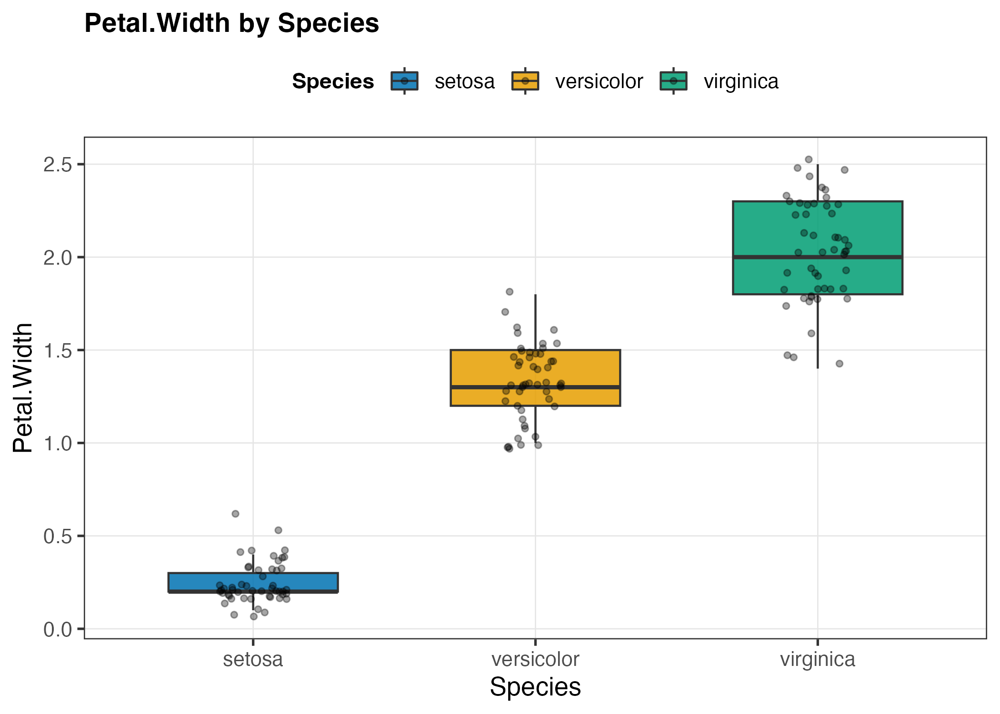
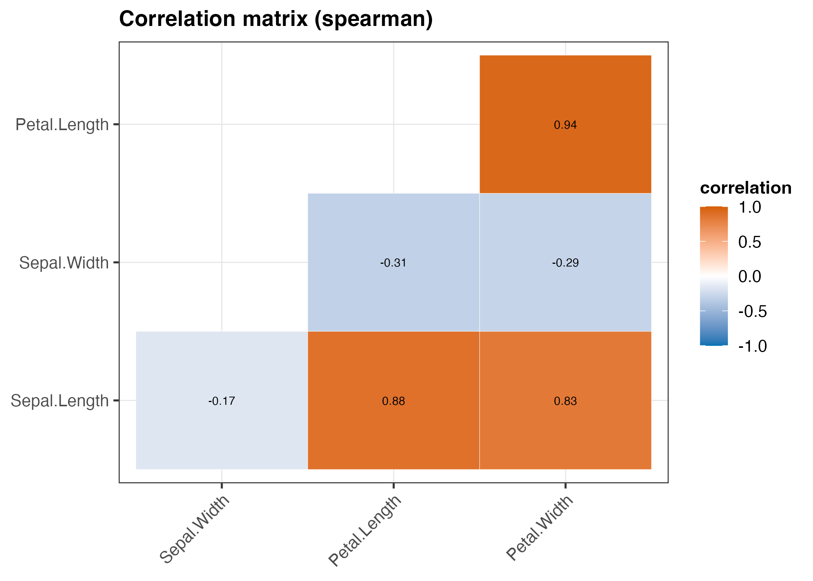

# Worked Example: `iris.csv`

The built-in `iris` dataset: 150 rows, 4 continuous measurements, 1 categorical label. Exported with `write.csv(iris, "iris.csv", row.names = FALSE)`.

## Step 1: Profile

```
Rscript scripts/01_profile_data.R iris.csv out_iris
```

```
       column    r_type            role n_missing pct_missing n_unique
 Sepal.Length   numeric      continuous         0           0       35
  Sepal.Width   numeric      continuous         0           0       23
 Petal.Length   numeric      continuous         0           0       43
  Petal.Width   numeric      continuous         0           0       22
      Species character categorical_low         0           0        3

Continuous/discrete-numeric columns: 4
Candidate grouping columns (categorical_low): Species
-> correlation matrix + pairwise scatter of the most correlated pair is worthwhile
```

All 4 measurements are continuous with no missing data; `Species` (3 levels) is the obvious grouping column. `01_profile_data.R` also writes `session_info.txt` (R/package versions) to `out_iris/` — useful if a later step hits a version-dependent rendering issue (see Step 5).

## Step 2: Plan

Nothing unusual here — straightforward case. Group column = `Species`. Expect the correlation matrix to reveal that petal measurements dominate species separation (this is the textbook result for iris).

## Step 3: Explore

```
Rscript scripts/02_explore_columns.R iris.csv out_iris scripts/cb_theme.R
```

```
[plot] Sepal.Length -> eda_Sepal.Length.png | Shapiro-Wilk W=0.976 p=0.0102 (non-normal)
[plot] Sepal.Length by Species -> eda_Sepal.Length_by_Species.png | Kruskal-Wallis chi-sq=96.94 p=8.92e-22
[note] Dunn post-hoc for Sepal.Length (BH-adjusted): significant pairs (p<.05): setosa-versicolor, setosa-virginica, versicolor-virginica
[plot] Sepal.Width -> eda_Sepal.Width.png | Shapiro-Wilk W=0.985 p=0.101 (approx. normal)
[plot] Sepal.Width by Species -> eda_Sepal.Width_by_Species.png | One-way ANOVA F=49.16 p=4.49e-17
[note] Tukey HSD post-hoc for Sepal.Width: significant pairs (p<.05): versicolor-setosa, virginica-setosa, virginica-versicolor
[plot] Petal.Length -> eda_Petal.Length.png | Shapiro-Wilk W=0.876 p=7.41e-10 (non-normal)
[plot] Petal.Length by Species -> eda_Petal.Length_by_Species.png | Kruskal-Wallis chi-sq=130.41 p=4.8e-29
[note] Dunn post-hoc for Petal.Length (BH-adjusted): significant pairs (p<.05): setosa-versicolor, setosa-virginica, versicolor-virginica
[plot] Petal.Width -> eda_Petal.Width.png | Shapiro-Wilk W=0.902 p=1.68e-08 (non-normal)
[plot] Petal.Width by Species -> eda_Petal.Width_by_Species.png | Kruskal-Wallis chi-sq=131.19 p=3.26e-29
[note] Dunn post-hoc for Petal.Width (BH-adjusted): significant pairs (p<.05): setosa-versicolor, setosa-virginica, versicolor-virginica
[plot] Species -> eda_Species.png | 3 unique values
[plot] Species | Chi-square goodness-of-fit (vs. uniform) X-sq=0 p=1

[note] correlation method: spearman (3/4 columns non-normal per Shapiro-Wilk)
[plot] correlation matrix -> eda_correlation_matrix.png (4 numeric columns)
[note] strongest pairwise correlation: Petal.Width vs Petal.Length (r=0.938)
Stats written -> out_iris/column_stats.csv
```

Notice `Sepal.Width` is the one column that routes to the *parametric* branch (ANOVA + Tukey HSD) — it's the only measurement where every species group passed Shapiro-Wilk and Levene's test agreed the variances were equal. The other three route to Kruskal-Wallis + Dunn. This routing is decided per column, automatically, from the per-group normality/variance checks — not hand-picked.

`column_stats.csv` now holds every test's statistic and p-value per column; `03_final_plots.R` (Step 5) uses it to pick the "most interesting" variable rather than defaulting to whichever column happens to be first.

## Step 4: Reassess

Nothing to fix — every continuous column got a histogram+density, every one was compared across `Species` with the correctly-routed test (three Kruskal-Wallis, one ANOVA), and the correlation matrix correctly surfaced `Petal.Length`/`Petal.Width` (Spearman rho = 0.94) as the strongest relationship. This is the "clean pass" case — most of the time steps 3-4 loop at least once (see the mtcars example for a case that needed a fix).

## Step 5: Finalize

```
Rscript scripts/03_final_plots.R iris.csv out_iris Species scripts/cb_theme.R
```

Produces 4 panels. Panel A is **not** simply "the first continuous column" — `03_final_plots.R` reads `column_stats.csv` and picks whichever column's grouped-comparison test had the lowest p-value. Here that's `Petal.Width` (Kruskal-Wallis p=3.26e-29, edging out `Petal.Length`'s p=4.80e-29), which also matches the dataset's actual textbook takeaway: petals separate species better than sepals do.



Panel C (below) is the correlation matrix, masked to one triangle with the diagonal dropped — the full symmetric 4x4 grid repeats every number twice for no benefit.



Panel B (`Petal.Length` vs. `Petal.Width` scatter, not pictured here) reports "Spearman rho = 0.94 (within-group: 0.27 / 0.79 / 0.36)" in its subtitle — the overall correlation is much stronger than any single species' internal correlation, a mild Simpson's-paradox-flavored pattern worth noticing before quoting the pooled 0.94 as if it held within each species.

## Takeaways

- Species clearly separates on petal measurements (large Kruskal-Wallis chi-squared, tiny p-values) — worth calling out explicitly in any write-up rather than just handing over the plots.
- Petal length/width are almost collinear (Spearman rho=0.94 pooled) — if this were feeding a regression rather than a plot, that pairing is a multicollinearity flag. But the much weaker within-species correlations (0.27-0.79) are the more honest number if the analysis is conditioning on species.
- Only `Sepal.Width` met the normality + equal-variance bar for a parametric test; the other three measurements needed Kruskal-Wallis. Don't assume one test for the whole dataset — `02_explore_columns.R` checks per column.
