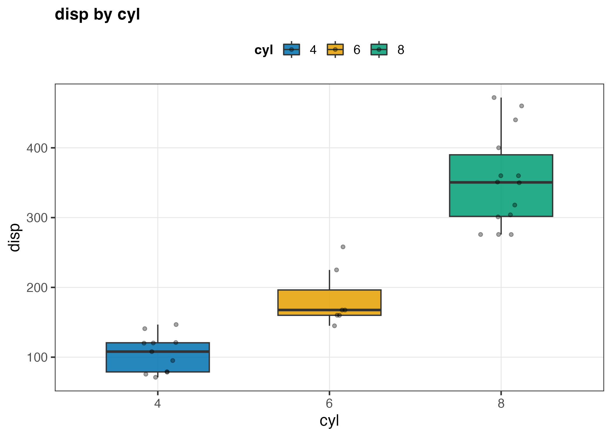
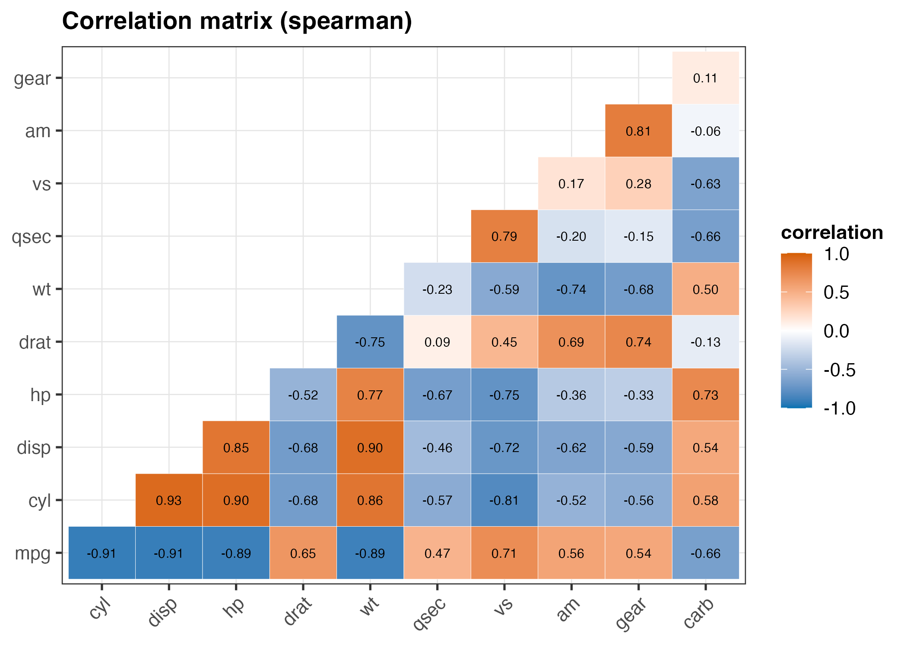

# Worked Example: `mtcars.csv`

The built-in `mtcars` dataset: 32 rows, 11 numeric columns + a car model name. Exported with `write.csv(rownames_to_column(mtcars, "model"), "mtcars.csv", row.names = FALSE)`. This example is the more interesting one — the first pass produced misleading plots, and the loop in the skill's workflow is what catches it.

## Step 1: Profile

```
Rscript scripts/01_profile_data.R mtcars.csv out_mtcars
```

```
 column  r_type             role n_unique
  model character       identifier       32
    mpg   numeric       continuous       25
    cyl   numeric discrete_numeric        3
   disp   numeric       continuous       27
     hp   numeric       continuous       22
   drat   numeric       continuous       22
     wt   numeric       continuous       29
   qsec   numeric       continuous       30
     vs   numeric discrete_numeric        2
     am   numeric discrete_numeric        2
   gear   numeric discrete_numeric        3
   carb   numeric discrete_numeric        6

Candidate grouping columns (categorical_low): cyl, vs, am, gear, carb
```

`model` is correctly flagged `identifier` (unique per row) and will be skipped. `cyl`, `vs`, `am`, `gear`, `carb` are all numeric but low-cardinality — `01_profile_data.R` classifies them `discrete_numeric` rather than `continuous` specifically so the next step doesn't histogram them.

## Step 2: Plan

`cyl` (3 levels: 4/6/8) is the natural grouping column — it's the first `categorical_low` candidate the profiler lists, ahead of `vs`/`am`/`gear`/`carb`. 11 numeric columns means a correlation matrix is worthwhile.

## Step 3: Explore (first pass, before the fix)

An earlier version of `scripts/02_explore_columns.R` routed every `continuous` **and** `discrete_numeric` column through the histogram+density branch. Running it on `vs` and `am` — true 0/1 flags — produced a bimodal "density" plot: a smooth curve fit through two spikes at 0 and 1, which misrepresents the data (there's no density *between* the two values; it's a count of two categories, not a continuum).

## Step 4: Reassess (the fix)

This is exactly the failure mode called out in `references/column_to_plot_guide.md` ("Numeric, `n_unique <= 2` → treat as categorical, not continuous"). The fix, applied in `scripts/02_explore_columns.R`:

```r
# before: role %in% c("continuous", "discrete_numeric") -> histogram+density
# after:
if (role == "continuous") {
  # histogram + density branch
} else if (role %in% c("categorical_low", "categorical_high", "discrete_numeric")) {
  # bar chart of counts branch — correct for vs/am/cyl/gear/carb
}
```

Re-running after the fix:

```
[plot] mpg -> eda_mpg.png | Shapiro-Wilk W=0.948 p=0.123 (approx. normal)
[plot] mpg by cyl -> eda_mpg_by_cyl.png | Kruskal-Wallis chi-sq=25.75 p=2.57e-06
[note] Dunn post-hoc for mpg (BH-adjusted): significant pairs (p<.05): 4-8
[plot] cyl -> eda_cyl.png | 3 unique values
[plot] disp -> eda_disp.png | Shapiro-Wilk W=0.92 p=0.0208 (non-normal)
[plot] disp by cyl -> eda_disp_by_cyl.png | Kruskal-Wallis chi-sq=26.68 p=1.61e-06
[note] Dunn post-hoc for disp (BH-adjusted): significant pairs (p<.05): 4-8, 6-8
[plot] hp -> eda_hp.png | Shapiro-Wilk W=0.933 p=0.0488 (non-normal)
[plot] hp by cyl -> eda_hp_by_cyl.png | Kruskal-Wallis chi-sq=25.22 p=3.34e-06
[note] Dunn post-hoc for hp (BH-adjusted): significant pairs (p<.05): 4-8, 6-8
[plot] drat -> eda_drat.png | Shapiro-Wilk W=0.946 p=0.11 (approx. normal)
[plot] drat by cyl -> eda_drat_by_cyl.png | Kruskal-Wallis chi-sq=14.39 p=0.000749
[note] Dunn post-hoc for drat (BH-adjusted): significant pairs (p<.05): 4-8
[plot] wt -> eda_wt.png | Shapiro-Wilk W=0.943 p=0.0927 (approx. normal)
[plot] wt by cyl -> eda_wt_by_cyl.png | Kruskal-Wallis chi-sq=22.81 p=1.12e-05
[note] Dunn post-hoc for wt (BH-adjusted): significant pairs (p<.05): 4-8
[plot] qsec -> eda_qsec.png | Shapiro-Wilk W=0.973 p=0.594 (approx. normal)
[plot] qsec by cyl -> eda_qsec_by_cyl.png | Kruskal-Wallis chi-sq=10.16 p=0.00623
[note] Dunn post-hoc for qsec (BH-adjusted): significant pairs (p<.05): 4-8
[plot] vs -> eda_vs.png | 2 unique values
[plot] am -> eda_am.png | 2 unique values
[plot] gear -> eda_gear.png | 3 unique values
[plot] carb -> eda_carb.png | 6 unique values

[note] correlation method: spearman (7/11 columns non-normal per Shapiro-Wilk)
[plot] correlation matrix -> eda_correlation_matrix.png (11 numeric columns)
[note] strongest pairwise correlation: disp vs cyl (r=0.928)
Stats written -> out_mtcars/column_stats.csv
```

`vs`/`am`/`gear`/`carb` are now bar charts of counts — correct, and their bars keep natural numeric order (`gear`: 3, 4, 5 left to right) rather than being reordered by frequency, since they're ordinal counts, not nominal categories. Note `cyl` is skipped in the "by cyl" boxplot loop (a column is never plotted grouped by itself), and every continuous-by-`cyl` comparison here lands on Kruskal-Wallis + Dunn — none of the six passed the "normal in every group AND equal variance" bar for the parametric branch, which isn't surprising with 3 very unevenly-sized groups (n=11/7/14) and real engineering data.

## Step 5: Finalize

```
Rscript scripts/03_final_plots.R mtcars.csv out_mtcars cyl scripts/cb_theme.R
```

Panel A is picked by ranking every continuous column's grouped-test p-value in `column_stats.csv`, not by column order in the CSV. `disp` wins (Kruskal-Wallis p=1.61e-06, the smallest of the six) — `mpg`, the first continuous column and what an order-based picker would have shown instead, is a close second (p=2.57e-06).



The combined 4-panel `patchwork` figure hit a second, unrelated issue on this machine — see below — but all 4 individual panels rendered correctly.



The correlation matrix is masked to one triangle with the diagonal dropped — at 11 columns the full symmetric grid was cramped and repeated every number twice. It also uses Spearman, consistent with step 3's own correlation-method decision (7 of 11 columns non-normal) — `03_final_plots.R` recomputes this decision itself from the raw data rather than trusting a cache, specifically so it can't silently disagree with what step 3 already printed.

The `disp` vs. `wt` scatter (Panel B, not pictured) uses **Pearson**, not Spearman — its correlation-method decision only looks at the 6 `continuous` columns (`mpg`, `disp`, `hp`, `drat`, `wt`, `qsec`), 4 of which are normal, versus Panel C's decision over all 11 `continuous` + `discrete_numeric` columns. Same dataset, two different column sets, two different — both correct — answers. Its subtitle reads "Pearson r = 0.89 (within-group: 0.86 / 0.47 / 0.76)": the within-cylinder correlations are all weaker than the pooled figure, most so for 6-cylinder cars, worth a caveat if this pairing goes into a write-up.

## A second issue caught by actually running the script

`wrap_plots(panels) |> ggsave()` failed with:

```
Error in Ops.data.frame(guide_loc, panel_loc) :
  '==' only defined for equally-sized data frames
```

This is a version incompatibility between `patchwork` 1.1.2 and `ggplot2` 3.5.1's rewritten guide system (`patchwork` >= 1.2.0 fixes it) — not a bug in the plotting logic. Since the 4 individual panels had already saved successfully, `scripts/03_final_plots.R` wraps the combine step in `tryCatch()` so this failure degrades gracefully (a warning + skip) instead of losing work already done. This is the kind of thing step 4 (reassess) is for: read the actual error, don't assume the script is broken end-to-end, and don't let a nice-to-have (combined panel) block the deliverable (individual panels). `out_mtcars/session_info.txt` (written by step 1) is exactly what you'd check to confirm the patchwork version.

**A third issue, found by checking the output directory, not just the console log:** the first version of the `tryCatch` fix left a `final_summary.png` behind anyway — 0 bytes of useful content, just a blank white 3600x2700 image. `ggsave()` opens its PNG device before the guide-collection error fires, so `on.exit(dev.off())` still flushes an empty file even though the plot itself never rendered. A directory listing alone said "success" (`final_summary.png` exists); opening the file said otherwise. The fix: `unlink(summary_path)` inside the error handler, so a failed combine leaves no file rather than a misleading blank one. Lesson: checking that a script *produced a file* is not the same as checking that the file is *correct* — open the output. (`scripts/04_review_checks.R` now flags any `final/*.png` under 3KB as a blank-file suspect, for exactly this reason.)

## Takeaways

- `disp` and `cyl` are the most correlated pair (Spearman rho=0.93) — engine displacement scales directly with cylinder count, unsurprising but worth confirming rather than assuming.
- Every continuous variable differs significantly across `cyl` groups (all Kruskal-Wallis p < .001), and `disp` separates them most cleanly — cylinder count is a strong stratifying variable for this dataset, consistent with `mpg`, `hp`, `wt` all being engine-size-driven.
- The same 11 columns can legitimately get two different correlation-method verdicts (Pearson for the 6 continuous-only pair in Panel B, Spearman for the full 11 in Panel C) depending on which columns are actually being compared — not a bug, but worth knowing before asking "why don't these two numbers use the same method."
